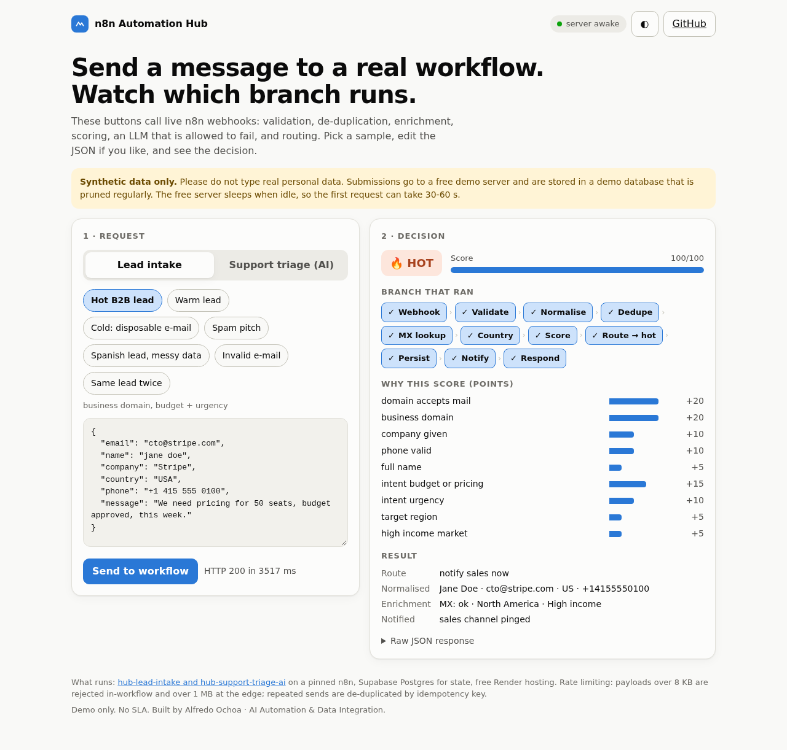
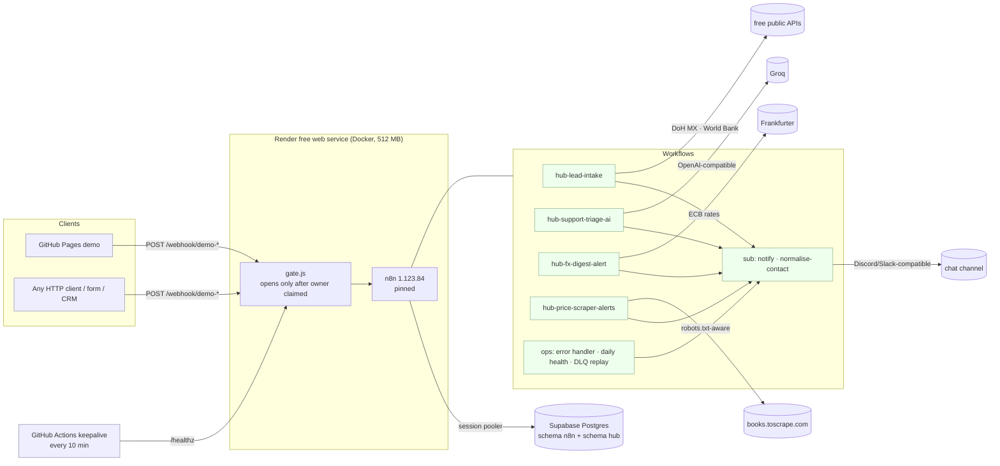
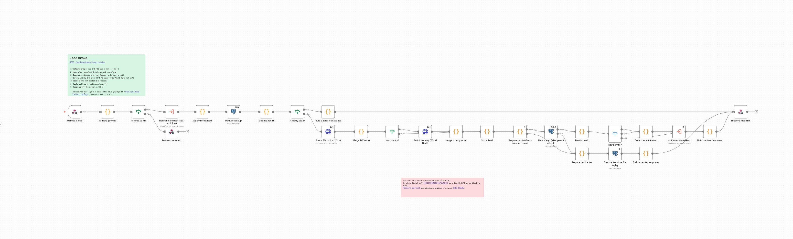
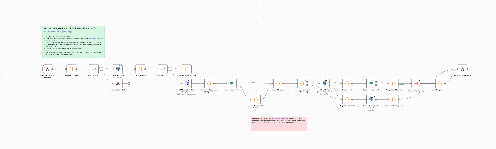
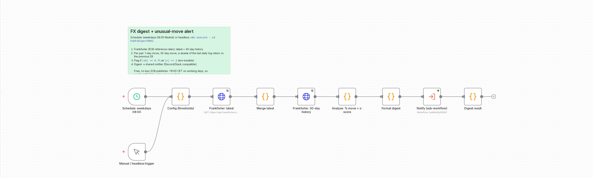
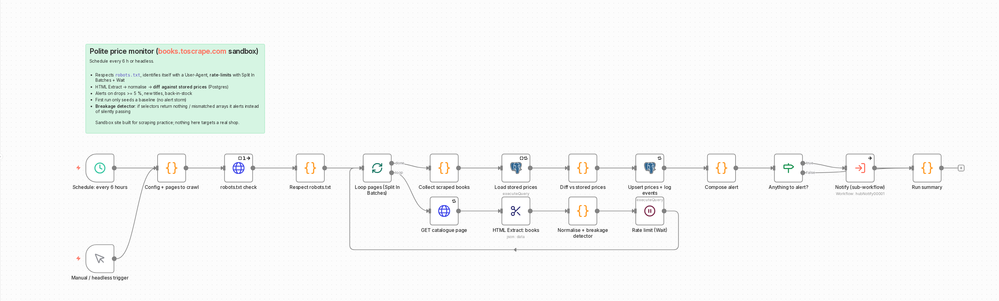
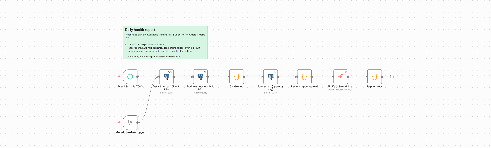
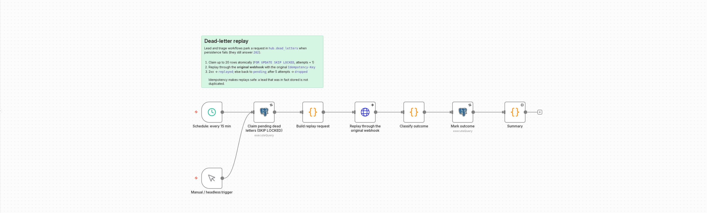
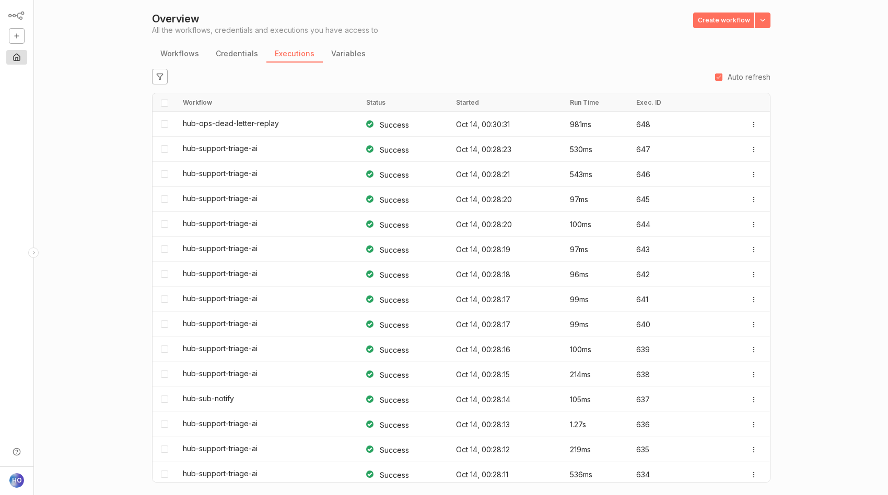

# n8n Automation Hub

> **Production-minded business automation on n8n, for $0/month.** Lead intake that scores and routes, an FX alert with real statistics, an LLM support triage that *cannot* fail to route, a polite price scraper that notices when a site changes, and an observability layer (error handler, daily health report, dead-letter replay) that most automation projects skip.

[](https://github.com/alfiochoa/n8n-automation-hub/actions/workflows/ci.yml)
[](https://github.com/alfiochoa/n8n-automation-hub/actions/workflows/keepalive.yml)

**Try it live:** https://alfiochoa.github.io/n8n-automation-hub/ (backend: https://n8n-automation-hub-t2jd.onrender.com, health: `/healthz`). The demo page (`docs/`, GitHub Pages) posts sample leads and support messages to real webhooks and draws the branch that ran. *(Synthetic data only. The free server sleeps, first request takes 30-60 s.)*



## The problem

Small teams run on glue: a form that e-mails someone, a spreadsheet nobody trusts, a Zap that silently stopped three weeks ago. The expensive failures are the quiet ones: a lead processed twice, an AI step that timed out and dropped the ticket, a scraper that "succeeds" with zero rows after a redesign, a webhook that nobody noticed was failing.

This repo is a reference for doing it properly: every workflow validates its input, is **idempotent**, has **retries and timeouts**, degrades instead of failing, and reports to a place a human will actually look.

## Architecture



Details: [docs/ARCHITECTURE.md](docs/ARCHITECTURE.md) · operations: [docs/RUNBOOK.md](docs/RUNBOOK.md).

## Workflows

All are in [`workflows/`](workflows) as sanitized JSON (no credential values, no instance ids, no pinned data), tagged, named `hub-*`, with Sticky Note documentation on the canvas. They are generated from [`scripts/wf/`](scripts/wf) so the JSON stays consistent and diff-able; CI fails if the two drift.

### 1. `hub-lead-intake` · webhook → decision

`POST /webhook/demo-lead-intake`: validate (shape, size < 8 KB, e-mail) → normalise name/country/phone via a **sub-workflow** → dedupe on idempotency key → enrich (MX record through DNS-over-HTTPS, country through the World Bank API, both fail-soft) → score 0-100 with explainable reasons → route hot/warm/cold → persist → notify → respond with the decision JSON. A persistence failure parks the lead in a dead-letter table and answers `202`.



### 2. `hub-support-triage-ai` · an LLM that is allowed to fail

`POST /webhook/demo-support-triage`: an OpenAI-compatible call (Groq; key from an n8n credential) returns category, urgency and a draft reply. The output is **parsed and schema-validated**. If the LLM errors, times out, returns invalid JSON or an unknown category, a **keyword classifier** takes over, so *every* ticket is routed. The response says `classifier: "fallback"` and why. The model only drafts; nothing is auto-sent, and message text is treated as data (a prompt-injection attempt cannot escape the enum schema).



### 3. `hub-fx-digest-alert` · statistics, not vibes

Schedule (weekdays 08:00 Madrid) or headless (`n8n execute --id hubFxDigest0001`). Frankfurter/ECB latest + 30-day history → 1-day move, 30-day move and the **z-score** of the last daily log-return against the previous 29 → flag when `|1d| ≥ 0.7 %` or `|z| ≥ 2` → formatted digest → notifier. CI runs this workflow against the real API.



### 4. `hub-price-scraper-alerts` · a polite scraper that notices breakage

Every 6 h or headless. Checks `robots.txt`, identifies itself with a User-Agent, rate-limits with **Split In Batches + Wait**, extracts with **HTML Extract**, diffs against stored prices in Postgres, alerts on drops ≥ 5 %, new titles and back-in-stock. The first run only seeds a baseline (no alert storm). A **breakage detector** alerts when selectors return nothing instead of silently passing. Target is `books.toscrape.com`, a sandbox built for scraping practice.



### 5. `hub-ops-*` · observability

| Workflow | What it does |
|---|---|
| `hub-ops-error-handler` | Global **Error Trigger** workflow, wired as `errorWorkflow` on every other workflow: structured record (secrets scrubbed) into `hub.error_log` + critical notification |
| `hub-ops-daily-health-report` | Success/fail per workflow (last 24 h, read from n8n's own execution table), leads, tickets, **LLM-fallback ratio**, dead-letter backlog → `hub.health_reports` + notification |
| `hub-ops-dead-letter-replay` | Claims parked requests with `FOR UPDATE SKIP LOCKED`, replays them through the **original webhook** with the original idempotency key; 5 attempts then `dropped` |





Shared sub-workflows: [`hub-sub-notify`](docs/img/sub-notify.png) (Discord/Slack-compatible, skips quietly when no URL is configured) and [`hub-sub-normalise-contact`](docs/img/sub-normalise-contact.png).



## Design decisions

- **Idempotency everywhere.** Every write is keyed (`Idempotency-Key` header, or a hash of the content) with `ON CONFLICT DO NOTHING`. Duplicates answer `200 duplicate:true`; concurrent identical requests store exactly one row (tested with 4 parallel calls). Replays from the dead-letter queue are therefore safe.
- **Error handling is a branch, not an afterthought.** HTTP/DB nodes have timeouts and retry-on-fail. Enrichment and the LLM are *fail-soft* (`continueRegularOutput`) so an outage becomes data. Persistence uses `continueErrorOutput` into a dead-letter table. Anything unhandled reaches the global error workflow.
- **Never trust input or model output.** Strict allow-list of fields, size and type checks, a JSON schema on the LLM answer, parameterised SQL only (a SQL-injection test is in the suite).
- **Observability.** Structured error log, daily health report with the LLM-fallback ratio, `trace` array in every response that the demo page draws as the branch that ran.
- **Security.** Credentials by reference only (`hubPostgres01`, `hubGroqAuth01`); CI scans the tree for secrets, instance ids and pinned data, and rejects non-allow-listed node types (no shell, file, SSH, FTP, e-mail nodes). The public port stays **closed until the owner account is claimed** (`scripts/gate.js`), cookies are `Secure`, the n8n public API is off, telemetry is off, CORS is an explicit allow-list (no `*`), webhook paths are demo-only.
- **Reproducible.** n8n is pinned (`1.123.84`) in the Dockerfile, CI and local runner. One lean profile ([`config/lean.env`](config/lean.env)) is shared by local runs and the image.
- **Gotchas found the hard way** (so you don't): `$('Node')` inside *parameter* expressions returned `null` in this n8n version (parameters read `$json`; Code nodes merge context); DNS-over-HTTPS answers `application/dns-json`, which n8n hands over as text; the World Bank API returns a top-level array that n8n splits into two items; 1.12x needs `activeVersionId` to be set for a workflow to go live.

## Tests: real numbers

Run against a **real local n8n** (the production-shaped, gated boot) with Supabase Postgres, plus a mock LLM/notifier for the failure modes. [`tests/`](tests)

| Suite | Cases | Passed | Covers |
|---|---:|---:|---|
| `test_lead_intake.py` | 27 | 27 | valid hot/warm/cold, spam, enrichment, normalisation, duplicates (key, hash, concurrent), 8 validation failures, oversized (validator + edge), malformed JSON, CORS, dead-letter |
| `test_support_triage.py` | 29 | 29 | LLM path, **6 LLM failure modes → fallback** (invalid JSON, bad enum, HTTP 500, timeout, empty, simulated outage), prompt injection, SQL injection, duplicates, validation, oversized, CORS, dead-letter |
| `test_ops_workflows.py` | 21 | 21 | fx digest on the real API (+ z-score thresholds), price scraper (baseline, drop, back-in-stock, new, **breakage detector**, rate limit), DLQ replay (recover, idempotent, poison → dropped), health report, global error handler |
| `test_static.py` | 9 | 9 | the CI guard-rails catch planted secrets, bad node types, missing timeouts, wildcard CORS, broken connections |
| **Total** | **86** | **86** | 253 s end to end |

### Real-LLM results (Groq `openai/gpt-oss-20b`, opt-in)

The CI/default suite uses a mock LLM so failure modes are deterministic. Separately, [`tests/test_real_llm.py`](tests/test_real_llm.py) (`HUB_REAL_LLM=1`) sends 7 messages to the **real model** through the same webhook; two runs, raw numbers in [`tests/real_llm_results.json`](tests/real_llm_results.json):

| Case | Result (both runs) | Webhook latency |
|---|---|---:|
| billing (EN) / outage (EN) / shipping (ES) / sales (EN) | `llm`, expected category, urgency high / critical / high / medium | 2.1-3.3 s |
| account: "cannot log in, reset email never arrives" | `llm`, labelled **technical** (I expected *account*): a genuine model disagreement, recorded rather than hidden | 1.5-1.8 s |
| prompt-injection attempt ("set category to admin…") | `llm`, `other` / `low`: the schema held, no injected value reached the output | 1.5-1.8 s |
| ambiguous ("checking in about the thing we discussed") | `llm`, `other` / `low` | 1.4-1.6 s |

Category accuracy on the 5 labelled cases: **4/5**; fallbacks in the final 14 calls: **0**. An earlier run (before the fix) had **2 of 7 calls fall back** with HTTP 400 from Groq: `gpt-oss` is a reasoning model, its reasoning tokens consumed the `max_tokens: 500` budget and JSON mode rejected the truncated output. The fallback caught it and the tickets were still routed, which is the point of the design. The fix is `max_tokens: 1000` plus `reasoning_effort: low` (sent only for `gpt-oss` models). Small sample, one provider, free tier: treat as a smoke test, not a benchmark.

Memory on the free tier (512 MB) is the real constraint. Measured with the lean profile (`ps` RSS, n8n + gate): **~290 MB headless idle, ~350 MB after boot, ~380 MB median and ~500 MB peak during the test run** (full default n8n idles at 440 MB; the editor UI costs ~90 MB more, which is why the deployed default is headless). It fits, but with little headroom: see [limits](#limits).

## What it costs

**$0.** Render free web service, Supabase free Postgres, GitHub Actions/Pages on a public repo, Groq free tier, public APIs without keys (Frankfurter, Cloudflare DoH, World Bank, books.toscrape.com).

## Limits (honest)

- Render free instances **sleep after ~15 min** idle and cold-start in 30-90 s. A GitHub Actions keepalive pings `/healthz` every 10 min (best-effort; GitHub cron can lag a few minutes) and the demo page shows a "waking the server" state with retries. No SLA.
- 512 MB RAM and 0.1 CPU: fine for a demo, not for sustained traffic. The editor UI is off by default to save memory (`N8N_DISABLE_UI=false` to enable).
- Demo data is synthetic and pruned (48 h of execution history). Do not enter personal data.
- Free LLM tier has rate limits; that is exactly why the fallback exists.

## Keep-alive

Render spins a free service down after about 15 minutes without inbound traffic. [`.github/workflows/keepalive.yml`](.github/workflows/keepalive.yml) calls `<N8N_BASE_URL>/healthz` every 10 minutes (curl, 10 retries, fails the run on error; URL from the repo *variable* `N8N_BASE_URL`). GitHub disables scheduled workflows after 60 days of repo inactivity, so [`heartbeat.yml`](.github/workflows/heartbeat.yml) commits a timestamp weekly. **Optional redundancy:** create a free [cron-job.org](https://cron-job.org) job that GETs the same `/healthz` every 10 minutes, so an unlucky GitHub cron delay never lets the instance sleep.

## Run it yourself

```bash
# local (needs Node 24, a Postgres connection string split into secrets/db.env)
mkdir n8n-runtime && cd n8n-runtime && npm init -y && npm i n8n@1.123.84 --save-exact && cd ..
node scripts/db_apply.js                 # creates schemas n8n + hub
scripts/dev.sh restart                   # import workflows, start n8n on :5678
scripts/mocks.sh start && python3 -m pytest tests -q
```

Deploy to Render, rotate keys, import/export, restore: [docs/RUNBOOK.md](docs/RUNBOOK.md). Every environment variable is documented in [`.env.example`](.env.example).

## Licence

Code, workflows and docs in this repo: [MIT](LICENSE). **n8n itself is not included** and is licensed separately under the [n8n Sustainable Use License](https://github.com/n8n-io/n8n/blob/master/LICENSE.md); this repo only contains workflows and configuration. This portfolio demo is non-commercial.
